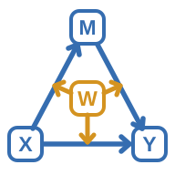

# PathLab



Mediation, Moderation and Conditional Process Analysis. Version 0.4.6 is a release
candidate under GPL version 2 or later. PathLab has not yet been published or
accepted by the jamovi Library. The module-only license does not apply to its
private parent application or repository history. The proposed first public
release is **0.4.6, public beta**, subject to owner approval and Library review.

The current Windows x64 jamovi 28.14/R4.6 installer passed 147 installed cases /
58,289 assertions and targeted Desktop cache, gallery-size, save/reopen and
HTML checks. A separate retained 2.7.39/R4.5 installer has earlier-source evidence;
it is not an exact-source 2.7 GUI pass for the latest changes. Other operating
systems/architectures and Cloud remain unverified. See [VALIDATION.md](VALIDATION.md).

The 20,000-dataset [simulation report](release-review/simulations/REPORT.md)
records parameter recovery, interval coverage, false positives and failures.
In one sparse categorical N=100 design, 164/1,000 fits failed and a selected
null indirect excluded zero in 89/836 successful fits (10.65%). Double-null
serial products were conservative. These are bounded study results, not a
universal N rule or guarantee of nominal 95% coverage. Review
[METHODS.md](METHODS.md) before interpreting inference. External statistician
peer review has not yet been obtained.

The original icon depicts the conceptual structure commonly called PROCESS
Model 59: W moderates X -> M, M -> Y and X -> Y. The shapes are unfilled,
with blue outlines and letters for X/M/Y and gold for W. PathLab is independent
of PROCESS and Andrew F. Hayes. This image is
branding; your selected arrows define the fitted model. In the tested jamovi
2.7.39 application, toolbar icons are defined in the host application's CSS;
the module compiler does not accept a custom toolbar icon. The artwork is
included for documentation and future host integration, not advertised as an
installed toolbar replacement.

The canonical SVG and transparent PNG are in `inst/branding/`; see their
[usage notes](inst/branding/README.md). Use the PNG where SVG is unsupported.

The R computation layer runs locally with base R regression. The native jamovi
analysis has two editors for the same graph computation layer. **Original editor**
retains the optional M1/M2/W controls and saved analyses. **General graph**
accepts up to ten ordered continuous mediators, three moderators and twenty
covariates, with explicit path and interaction rows. X, moderators and covariates
can be categorical with explicit reference coding. Y can be continuous or binary
logistic; mediators remain continuous. The legacy
mode remains the default so an existing saved specification is preserved.
No selected arrow is silently removed. All mediator paths must lie on an X-to-Y
route. A model needs at least one mediator or a moderated path. Structural and
computational limits are documented in [FEATURES.md](FEATURES.md).

## Quick start

### Native plots

Plot and optional-output changes reuse the last valid fitted summary and its
bootstrap intervals, including after save/reopen. Changing data, model paths,
coding, probes, seed, draw count or inference settings computes a new fit.
Incomplete or failed models clear the cache. The reproduction JSON records
whether a fit was computed or reused, with its identity and creation time.
Tables and images are still refreshed, so large output may take time to display.

Native plot resize options also preserve the fitted summary. Click an image to
focus it, then drag its lower-right resize handle; horizontal scrolling may be
needed to reach the corner. Very small canvases reduce text and margins, but
normal sizes are preferable for reading labels. Saved `.omv` files retain image
dimensions, the model, filters, missing-value definitions and the fitted cache.

While fitting, the status reports bootstrap progress. Editing model or inference
settings interrupts the superseded calculation and starts the current request.
Cancelled work publishes no partial estimates or intervals. A completed fit is
retained if only its presentation was interrupted. The engine polls between
small bootstrap batches and result pages; an individual regression or other
atomic operation must finish before the next poll.

Expand **Effect, interaction and Johnson–Neyman plots** to request any of the
three native, resizable graphs. They are off by default to preserve old saved
analyses. Choose an effect kind and page (12 estimands per page); every selected
row remains accessible. Effect intervals are the fitted percentile bootstrap
intervals, including paired contrasts when selected.

Under **Fitted interaction plot**, choose **Interaction plots to display → All
moderated arrows (six per page)** to see each declared arrow/moderator slice.
Use **Interaction plot page** for later images in larger models. The selected
arrow controls still choose the Johnson–Neyman graph. Other moderators use the
selected fixed probe combination; joint interactions appear as conditional
slices for each attached moderator. Gallery mode, pages and resizing reuse the
completed fit and bootstrap intervals.

For interaction and JN graphs, select an explicitly declared arrow, its attached
moderator, and a fixed probe-combination number. Combination order is the saved
`plot_conditions` list in reproduction JSON. Other moderators use that combination;
other equation predictors are held at common-sample means or declared references.
Interactions show conditional fitted means, or event probabilities / log odds for
a logistic outcome. Their analytic intervals are for means, not individual cases.
Categorical source levels are separate points. JN graphs show conditional path
slopes over the observed continuous moderator range, with analytic pointwise
intervals, exact in-range boundaries and shaded significant regions. Choose a
focal category contrast when the source is categorical. Categorical moderators
have no JN region. All intervals are pointwise with no multiplicity adjustment;
these graphs do not establish causal effects or indirect-effect JN regions.

### Filters, missing values and file formats

jamovi applies active filters and user-defined missing-value rules before
PathLab receives data. PathLab then uses one common complete-case sample for
all equations. The status distinguishes rows delivered by jamovi from included
complete cases. Exclusion positions refer to that delivered frame. When jamovi
supplies unique positive integer row names, reproduction JSON also records
`delivered_row_numbers` and `included_row_numbers` for the original row mapping.
Arbitrary text row labels are not serialized.

Use `.omv` for a full analysis round trip. HTML exports retain native result
tables and embedded plot images. In the tested jamovi 2.7.39 CSV export, only
filtered-in rows and data columns are exported; numeric missing-value codes
remain numbers. A fresh CSV import carries no analysis, filter definition or
user-missing rule. Reapply the intended rules before analysis. Special Import
can replace data while retaining the current model and definitions; changed
values invalidate the fitted cache. Current tested formats and limits are in
[VALIDATION.md](VALIDATION.md).

### Synthetic example

The three synthetic CSV examples are registered in **Open → Data Library →
PathLab**. They also remain under `inst/examples/` with model recipes. No
research participants' data are included.

1. Install the locally reviewed installer using jamovi's Modules → Side-load.
   The development target is Windows x64, jamovi 2.7 with bundled R 4.5.0.
   Confirm the current build, installation and Desktop evidence in
   [VALIDATION.md](VALIDATION.md). Other targets are untested.
2. Open `inst/examples/serial-first-stage.csv` in jamovi. All rows are synthetic.
3. Open **PathLab → Mediation and Moderation**. Under **Original editor**, assign X=`x`, M1=`m1`, M2=`m2`,
   Y=`y`, W=`w`. Keep the six X/mediator/outcome arrows and W→M1 selected.
4. Select W moderation of X→M1. Leave the other moderator attachments off.
5. Start with 200 bootstrap draws, seed 419, 95% intervals. Choose classical
   covariance to reproduce the supplied coefficient reference. For substantive
   inference, increase draws after reviewing the model and sample.
6. Inspect the resolved graph diagram, fitted equations, estimates, conditional
   effects, paired contrasts, path slopes and applicable Johnson-Neyman boundaries.
   **Additional output** can reveal the full coefficient covariance and the
   reproduction JSON/diagnostic details. These detailed results are optional.
   The saved-index fixtures provide exact Python/R bootstrap comparisons;
   R's ordinary seed 419 uses a different RNG from Python.

The initial equations are:

```
M1 = intercept + a*X + d*W + aw*X*W + error
M2 = intercept + a2*X + d21*M1 + error
Y  = intercept + cprime*X + b1*M1 + b2*M2 + error
```

Specific indirect associations are `(a+aw*W)*b1`, `a2*b2` and
`(a+aw*W)*d21*b2`. The last is the serial route. Their sum is the total indirect
path association. An explicitly omitted direct arrow has a structurally zero
direct association and is absent from the fitted equation.

For simple mediation, assign X, M1 and Y, keep X→M1, M1→Y and the desired direct
X→Y arrow, and explicitly deselect arrows involving unused M2/W roles and all
unused moderation attachments. For ordinary moderation, assign X, W and Y, select
X→Y and W→Y, attach W to X→Y, and deselect arrows/attachments involving mediators.
Leaving a role empty never silently deletes a selected arrow.

The equation-specific covariate controls add each selected covariate
only to its assigned M1, M2 or Y equation. Declare categorical adjustment roles
using the coding controls described below. A covariate can appear in several
equations; every selected graph variable still contributes to the common
complete-case sample. A covariate cannot also occupy X, Y, mediator or W roles.

## General graph editor

Select **General graph** under **Model editor** to specify larger models. Assign X and Y, then add
mediators, moderators and covariates in the intended order. Mediator slots are
M1 through M10; moderator slots are W, Z and V; covariate slots are C1 through C20.
The slots refer to the positions in their variable lists. Review every selected
row after reordering a list, because an arrow refers to its slot. The fitted
equations and diagram show the resolved column labels.

Use **Add arrow** for each selected path row. A source may be X, a mediator, a
moderator or a covariate; the target is a mediator or Y. A covariate enters only
the equations named in its path rows. Parallel, serial and combined mediation
use the same editor. List order labels the mediators; the explicit arrows
determine their directed graph. Cycles and mediators outside an X-to-Y route
are rejected.

Use **Add moderation** to choose an existing source/target arrow and one or two
moderators. Two moderators in the same row specify their joint three-factor
term with that arrow's source. All required main effects and lower-order
interactions must be selected explicitly. For example, X→M1 moderated jointly
by W and Z requires path rows X→M1, W→M1 and Z→M1, plus interaction rows:

| Source → target | First moderator | Second moderator | Term |
| --- | --- | --- | --- |
| X → M1 | W | none | X×W |
| X → M1 | Z | none | X×Z |
| W → M1 | Z | none | W×Z |
| X → M1 | W | Z | X×W×Z |

An interaction row never adds missing main-effect or lower-order rows for you.
An error identifies an incomplete hierarchy, duplicate term or unassigned slot.
There can be up to 150 path rows and 150 interaction rows, subject to estimation
and work limits. Each row supports at most two moderators; a four-factor
X×W×Z×V term is outside the supported subset.

W, Z and V each have a separate probe field. For a continuous moderator, leave it
blank for the original sample's 16th, 50th and 84th percentiles, or enter
comma-separated numerical values. A categorical moderator instead defaults to
all declared levels; custom category probes must name valid levels. Quote a label
containing a comma. Probe combinations are limited to 25. Three moderators with three values
each request 27 combinations, so set at least one moderator to one or two custom
values before fitting that model. The module rejects an over-budget request
instead of discarding conditions.

The supplied `inst/examples/general-joint-three.csv` contains 120 synthetic
rows for a larger worked example. Assign X=`x`, Y=`y`, mediators in order
`m1`, `m2`, `m3`, moderators `w`, `z`, and covariate `c1`. Add these arrows:

- X to M1, M2, M3 and Y.
- M1 to M2, M3 and Y.
- M2 to M3 and Y; M3 to Y.
- W to M1; Z to M1; C1 to Y.

Add the four interaction rows in the table above. Set both W and Z probes to
`-0.5,0.7`, use classical covariance, 200 draws and seed 17421. The accompanying
`general-joint-three-model.json` records these selections for R reproduction.
The GUI uses the native controls described above.

## Categorical predictors and moderators

In **Categorical predictors, moderators and covariates**, add one coding row for
each categorical X, moderator or covariate role and enter its exact reference
level. Numerical codes are quantitative scores until a coding row explicitly
declares them categorical. A text/factor exogenous column requires that row.
Mediators cannot be declared categorical.

Native factor columns retain their level order. Raw text columns use sorted
observed labels and raw numeric columns use sorted observed codes. Each categorical
role supports two to ten levels, and every declared level must occur in the
common complete-case sample. Inspect the coding table, which shows each level,
reference, indicator column and complete-case count. A change to a reference or
column's level metadata changes the fitted coding; check it after editing data.
The R API instead takes explicit typed `levels` and `reference` declarations.

PathLab estimates one contrast against the declared reference for each other X
level. Interactions expand those indicators using the explicitly selected graph
and hierarchy. Effects, slopes and paired differences identify the focal
contrast. Categorical moderators use level comparisons, without a numerical
derivative or Johnson–Neyman region. A numerical moderator can still have
conditional derivatives and JN slices at stated categorical levels.

For a worked example, open `inst/examples/categorical-linear.csv`. Assign X=`x`,
Y=`y`, mediators `m1`, `m2`, and moderator `w` in **General graph**. Add X→M1,
X→M2, X→Y, M1→M2, M1→Y, M2→Y and W→M1; add W moderation of X→M1.
Add coding rows X with reference `2` and W with reference `middle`. Leave W
probes blank, choose classical covariance, 200 draws and seed 19021. All 216
rows are synthetic. `categorical-linear-model.json` records the graph, explicit
R coding and native controls.

## Binary logistic outcome

Select **Binary logistic** under **Outcome model**, then enter the exact event
level. The named event is mapped to 1 and the other level to 0; missing values
remain missing. A blank event is defined only for levels 0 and 1 and selects 1.
The same explicit mapping works for numeric codes, text labels and factor labels.
The mapping is shown in the results. The R API accepts a numerical 0/1 outcome.

Use `inst/examples/categorical-logistic.csv` with the same graph and category
references as the preceding example; select Binary logistic and event `1`.
The accompanying model JSON includes both the R request and native controls.
Mediator equations use OLS; only the outcome equation uses logistic regression.
Review convergence, model likelihood, covariance choice and failed bootstrap
draws along with the fitted equations.

Binary-outcome indirect and summed associations are **statistical path products
on the log-odds equation scale**. They are not natural causal effects, probability
effects or odds ratios of an indirect effect. Logistic noncollapsibility also
prevents interpreting their summed total as a marginal total effect or a reduced
logistic coefficient that omits the mediators. See [METHODS.md](METHODS.md) for
the covariance calculation and separation checks.

General-mode effects, indices and paired contrasts are displayed in consecutive
tables with up to 50 rows each. Every table is visible, with its original row
range in the title; no output rows are omitted. Original-mode analyses retain
their existing single effects table. R callers use `result$effectPages$items`
and each table's `$asDF` in general mode, or `result$effects$asDF` in original
mode. The reproduction JSON still contains the complete ordered estimand list.

Derivative/index route labels state the actual moderator names and derivative
order, such as `[d/d w]` and `[d2/(d w d z)]`. Paired contrasts identify both
source estimands. This distinguishes W and Z indices without consulting JSON;
the label correction does not change the numerical arrays.

The 0.4.1 fit-cache build from `1d191e669756447cb42738b083291810abb69a5c`
passed 125 source cases/57,496 assertions, 22 installed-only cache/plot cases/
11,237 assertions and 88 Python regression tests. Twelve actual Desktop scenarios
passed 702 saved-file checks and nine cross-save checks. Plot edits and a separate
reopen reuse the exact fitted science; data, seed and model errors invalidate it.
The genuine 0.4.1 installer was built and installed. No local-target prerequisite
is missing. Remaining release work is in [VALIDATION.md](VALIDATION.md).

The historical corrected 0.4.0 plot build from `f211f019cca4efe2dbab609c6f3aba1bb52bffa8`
passed 120 source cases/57,265 assertions, 17 installed-only plot cases/11,007
assertions and the preserved 88-test Python process regression. Actual Desktop
serial, categorical joint and logistic scenarios passed 371 saved-file checks,
12 cross-save transition checks and 13 HTML PNG-export checks. This includes
save/reopen, missing cells and Undo, reference-error clearing/recovery,
categorical JN inapplicability and probability/log-odds scales. A categorical
legend rendering error found in Desktop was fixed and covered by real PNG
regressions. Its then-remaining selection transitions are now covered above;
resize and broader export QA remain listed in [VALIDATION.md](VALIDATION.md).
Historical version-specific evidence follows.

The native lifecycle replaces dynamic output rows on rerun and clears prior results when
the model becomes incomplete or fails. Active jamovi weights are explicitly
rejected. The historical 0.2.0 installed label-corrected Windows build passed the 74-case
numerical/native suite and actual synthetic general-model baseline,
invalidation/restoration, common-sample missing values and baseline save/reopen
checks. Exact scope and remaining release work are recorded in
[VALIDATION.md](VALIDATION.md).
A genuine 0.2.0 Windows installer was built and locally installed; installed files,
loaded code and the nine-file source manifest were verified. Version-specific
numerical and Desktop results are recorded there separately. The 0.1.1 milestone
is preserved as historical evidence for its original model and controls.
The categorical/logistic 0.3.0 focused suite passed eight cases and 11,364
assertions, including identical saved resamples, Python parity and independent
NumPy and R references. The genuine 0.3.0 installer was rebuilt and locally
installed from source `a0bd83c36b308d23725358614011346dae97355a`; its integrity
audit and installed 14-case/11,734-assertion suite passed without sourcing
workspace code. The frozen full-source suite passed 103 cases and 46,257
assertions with unchanged inputs. All seven actual Desktop reports passed
2,030 checks, covering categorical-linear and joint-logistic complete baselines
and separately saved reopens, common-sample missing values, visible error
clearing and restoration. VALIDATION.md records the exact actions and limits,
including the separately preserved first-build cached-diagram defect that the
final build resolves.

## Scientific validation

The [seeded simulation report](release-review/simulations/REPORT.md) records
parameter recovery, coverage, false positives and failures for 20,000 synthetic
datasets. Nominal 95% intervals do not guarantee 95% finite-sample coverage.
Sparse categorical cells can fail or show elevated false positives among
successful fits; double-null serial products can be conservative. Review actual
joint cell support and the bounded claims in METHODS.md.

## R API

```r
request <- jsonlite::fromJSON("inst/examples/serial-first-stage-model.json",
                              simplifyVector=FALSE)
data <- read.csv("inst/examples/serial-first-stage.csv", check.names=FALSE)
fit <- pathlab::pathlab_fit(data, request$graph, request$settings,
                           draws=200, seed=419, robust=FALSE)
# Native jamovi results classes, also callable from R:
tables <- pathlab::paths(data=data, x="x", m1="m1", m2="m2", y="y", w="w",
                        draws=200, seed=419, robust=FALSE)
# If present in data, covM1/covM2/covY accept character vectors of covariate
# column names. Add categoricalCoding rows for categorical adjustment roles.
# The same column may be assigned to several equations.
```

There is no login, Python dependency, network request or runtime package download
in either analysis route. A developer needs jmvtools to generate and build it.

Weighted/clustered analyses and categorical mediators remain unavailable.
Statistical path products
do not establish causation. See [METHODS.md](METHODS.md),
[FEATURES.md](FEATURES.md) and [CHANGELOG.md](CHANGELOG.md). The owner release
proposal remains in the private review materials outside the module-only source
archive. The parent application, private source repository
and Git history must stay private when preparing any module-only release.
