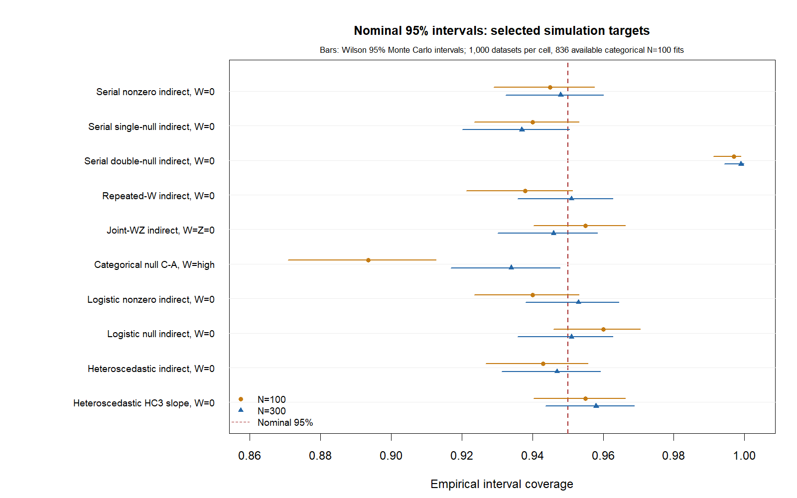

# PathLab simulation results: private release review

The frozen study completed **20,000 datasets**: 18,000 finite-parameter datasets
and 2,000 deliberate separation cases. Each estimable fit requested 2,000 paired
whole-case bootstrap resamples. Every scenario has 1,000 datasets at N=100 and
1,000 at N=300. These are measured pointwise results, not a blanket calibration
pass or evidence of causal identification.

## Source and reproducibility

Tested installed analysis source `b1beae8c08413ca38bcde1e142f2d513fcb0b9b0`;
installer SHA-256 `b762e3c5617d48483f2f01660e1fd480dcd0a1ad4e5ede1d8c2d14aae841bbd3`. Master seed 20261023.
[Frozen equations and outcome definitions](PROTOCOL.md), [machine protocol](protocol.json),
[all estimand summaries](estimand-summary.csv), [all cell/failure summaries](cell-summary.csv),
and [source-specific evidence and raw-file hashes](evidence.json) are included.
The pilot used first-replicate seeds later regenerated in the main run; it is
not an independent holdout and is not counted as additional data. No DGP or
replicate/draw count was tuned to make coverage pass. Initial execution used 14
R processes. An external process interruption left 152 complete batches;
48 incomplete/unstarted batches were regenerated in full with the same seeds,
using eight workers. Interrupted partial records were preserved separately and
are not counted twice or treated as statistical fit failures. All 20,000 final
dataset IDs are unique and accounted for. [Execution recovery](execution-recovery.json).

Reproduce a cell using an installed matching package:

```sh
Rscript simulation_study.R serial_alt 100 1 1000 2000 simulation-output
```

Run all ten scenario names below at both sample sizes. Outputs refuse to
overwrite existing status/metric files. The public R driver preserves the
generation, truth, independent-reference and production-fit code; only private
runtime discovery/source assertions were removed. Its calls use the installed
PathLab bootstrap, rather than an accelerated substitute estimator.

## Conditional indirect interval coverage and false positives

Ranges below are across the predeclared specific indirect conditions/contrasts,
not pooled independent tests. Success denominators exclude failed fits only
where explicitly shown. Every attempted fit remains in the failure table.

| Scenario | N | Successful fits | 95% indirect coverage | Null indirect false positives |
| --- | ---: | ---: | ---: | ---: |
| categorical | 100 | 836/1000 | 89.35–93.90% | 8.25–10.65% |
| categorical | 300 | 1000/1000 | 93.40–95.00% | 5.00–6.60% |
| heteroscedastic | 100 | 1000/1000 | 94.10–94.50% | — |
| heteroscedastic | 300 | 1000/1000 | 93.80–94.70% | — |
| joint_wz | 100 | 1000/1000 | 94.00–95.70% | — |
| joint_wz | 300 | 1000/1000 | 93.50–94.90% | — |
| logistic_alt | 100 | 1000/1000 | 94.00–94.90% | — |
| logistic_alt | 300 | 1000/1000 | 93.70–96.00% | — |
| logistic_null | 100 | 1000/1000 | 95.60–96.10% | 3.90–4.40% |
| logistic_null | 300 | 1000/1000 | 94.20–95.60% | 4.40–5.80% |
| repeated_w | 100 | 1000/1000 | 93.40–95.30% | — |
| repeated_w | 300 | 1000/1000 | 94.50–95.10% | — |
| separation_stress | 100 | 0/1000 | not applicable | — |
| separation_stress | 300 | 0/1000 | not applicable | — |
| serial_alt | 100 | 1000/1000 | 94.50–95.10% | — |
| serial_alt | 300 | 1000/1000 | 94.70–95.30% | — |
| serial_double_null | 100 | 1000/1000 | 99.40–99.70% | 0.30–0.60% |
| serial_double_null | 300 | 1000/1000 | 99.60–99.90% | 0.10–0.40% |
| serial_null | 100 | 1000/1000 | 93.10–94.20% | 5.80–6.90% |
| serial_null | 300 | 1000/1000 | 93.70–94.60% | 5.40–6.30% |

Coverage is the fraction of available intervals containing the declared truth.
For truth-zero effects the false-positive rate is the fraction excluding zero.
CSV files give counts, Wilson 95% binomial intervals, Monte Carlo SE, bias,
RMSE, empirical SD, bias MCSE and average interval width for every reported
coefficient, effect, derivative/contrast and HC3 path slope. With 1,000 datasets,
a rate near 95% or 5% has MCSE about 0.69 percentage points. Rows from one dataset
are correlated; no familywise error control is claimed.



## Selected parameter recovery

These fixed examples show coefficient and product recovery on their declared
scales. The parenthesized value is Monte Carlo SE of estimated bias, not the
standard error of an individual researcher's parameter estimate. All other
coefficient/effect rows are retained in the full CSV.

| Parameter | N | Truth | Mean estimate | Bias (MCSE) | RMSE |
| --- | ---: | ---: | ---: | ---: | ---: |
| X -> M1 | 100 | 0.500 | 0.5047 | 0.0047 (0.0032) | 0.1023 |
| X -> M1 | 300 | 0.500 | 0.5004 | 0.0004 (0.0018) | 0.0570 |
| M1 -> M2 | 100 | 0.600 | 0.6008 | 0.0008 (0.0026) | 0.0825 |
| M1 -> M2 | 300 | 0.600 | 0.6013 | 0.0013 (0.0015) | 0.0484 |
| M2 -> Y | 100 | 0.500 | 0.5026 | 0.0026 (0.0027) | 0.0839 |
| M2 -> Y | 300 | 0.500 | 0.4996 | -0.0004 (0.0016) | 0.0494 |
| Serial indirect at W=0 | 100 | 0.150 | 0.1522 | 0.0022 (0.0014) | 0.0447 |
| Serial indirect at W=0 | 300 | 0.150 | 0.1504 | 0.0004 (0.0008) | 0.0260 |
| Joint X*W*Z coefficient | 100 | 0.120 | 0.1175 | -0.0025 (0.0040) | 0.1274 |
| Joint X*W*Z coefficient | 300 | 0.120 | 0.1221 | 0.0021 (0.0020) | 0.0648 |
| Logistic M2 -> Y | 100 | 0.500 | 0.5256 | 0.0256 (0.0066) | 0.2093 |
| Logistic M2 -> Y | 300 | 0.500 | 0.5091 | 0.0091 (0.0036) | 0.1135 |

## Findings that matter for release

**Sparse categorical cells require a qualification.** At N=100, 164/1,000
datasets failed: 36 original unit-leverage/design rejections and 128 bootstrap
success-threshold failures. Thus only 836 supplied intervals. The rare C-vs-A
indirect effect at W=high was population-zero but rejected in
89/836 fits: **10.65% [8.73, 12.92]**.
Its successful-fit coverage was **89.35% [87.08, 91.27]**. Failure rate 16.4% has Wilson
95% interval 14.23–18.82%. Selecting only successful fits does not repair sparse
data or justify nominal 5% claims. At N=300, this DGP had no original/overall
failures, although 23 resamples failed; the same null indirect false-positive
rate was 6.6%. This is not a universal N=300 sufficiency rule.

**Composite-null products are conservative.** When both X -> M1 and M1 -> M2
were population-zero, indirect false-positive rates were 0.1–0.6%, rather than
5%. This is finite-sample product inference, not a coding error demonstrated by
the study. No interval method or failure threshold was changed to tune results.

**HC3 inference is measured separately.** In the specified heteroscedastic DGP,
X -> M1 simple-slope coverage across the six N/probe cells was
93.60–95.80%. Normal-reference HC3 intervals
are approximate; this small scenario set cannot establish calibration generally.

Bias/RMSE and all other rates, including logistic, repeated and joint moderator
derivatives and direct-null tests, must be read from their specific CSV row.
Nonzero logistic targets are log-odds coefficient path products. The deterministic
separation cases have no finite logistic truth; they are rejection tests and
are excluded from coverage calculations rather than treated as zero effects.

## Numerical validation and fix

Every successful original fit was checked against independently handwritten R
matrices, normal-equation linear estimates/covariances and stats::glm.fit logistic
estimates. Maximum absolute coefficient discrepancy 3.19e-12; covariance
discrepancy 1.96e-13; all below 1e-7. This bypasses the production graph
compiler for reference construction.

An additional independent R recalculation of 12
selected summary cells passed, including bias, SD, RMSE, literal interval/zero
exclusions and stats::prop.test score/Wilson intervals from raw job records.
[Aggregate cross-check](summary-crosscheck.json).

All **20 selected first-replicate cells** passed Python comparison using the
same saved 2,000 resample rows, with
**1,714,864 scalar comparisons** and maximum absolute
difference **1.01e-11**. Full bootstrap
distributions, published intervals, derivatives and paired contrasts agree.
The two separation cases agree on rejection. Main first-replicate data, index
files and R outputs were verified byte-identical to those replayed in the
parity run. [Detailed numerical evidence](python-parity.json).

Four additional sparse-data replays all failed in both implementations. The
two bootstrap-threshold cases share their error code; the two singleton-cell
cases are rejected earlier by R's original-fit unit-leverage guard, while Python
reaches a bootstrap-threshold failure. This is an explicitly documented stage
difference, not a claim that every rejection code is identical.
[Failure replay evidence](sparse-failure-replays.json).

The resulting R change makes the existing unit-leverage rejection actionable:
“At least one case has unit leverage; check singleton joint categorical cells
or an overfitted equation.” The rejection boundary, coefficients, covariance,
bootstrap and intervals are unchanged. A regression test covers the diagnostic
and unchanged coefficient-only bootstrap behavior. Release documentation now
states sparse-cell undercoverage and composite-null conservatism explicitly.
The rebuilt isolated installer from `6849ad9cf6c6e9072a2f11ca920fd7e05b400cd0` passed all
20 selected replay cells: all 18 successful complete scientific R objects were
bit-identical to the Python-validated simulation source; both separation
rejections agree. Classical and HC3 singleton diagnostics also passed.
[Rebuilt-installer replay evidence](fixed-installer-replays.json).

## Release decision

Simulation execution is complete. Universal nominal-coverage claims are **not
approved**. Keep the public-beta calibration/limitations decision open for
independent methods and owner review; improving or adding interval methods
would require a separately specified, independently validated design.
Current-series/platform compatibility and the final frozen-build Desktop sweep
also remain open. Nothing was uploaded, submitted or made public.
